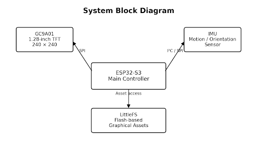
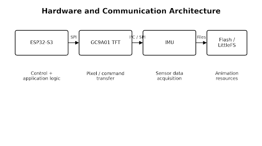
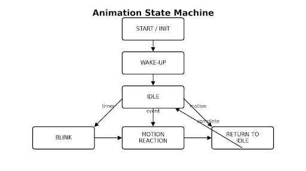
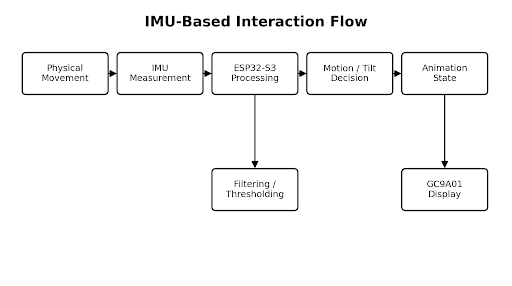
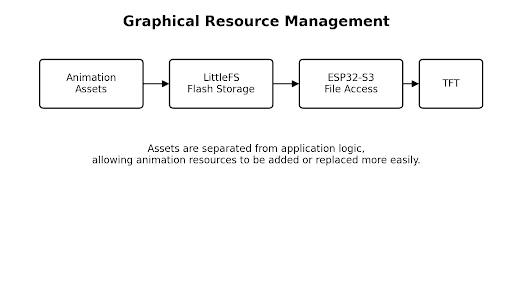
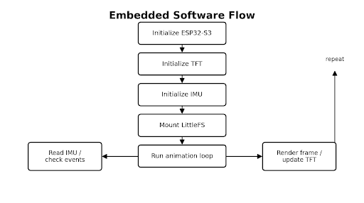

# Interactive Embedded Smart Display Prototype

**ESP32-S3 • GC9A01 TFT • IMU • LittleFS • Embedded C/C++**

An interactive embedded display prototype built around the **ESP32-S3**, a **1.28-inch 240 × 240 GC9A01 circular TFT**, an **IMU**, and **LittleFS** for graphical resource management.

The project brings together microcontroller programming, peripheral communication, graphical rendering, animation control, sensor acquisition, and flash-based resource management.

> **Repository status:** The complete firmware source is currently being consolidated and is not yet included. This repository contains the technical documentation, architecture diagrams, and project report rather than placeholder firmware.

---

## System Architecture



The ESP32-S3 acts as the central controller, coordinating the GC9A01 display, IMU and flash-based graphical resources.

---

## Hardware & Communication



### Main Hardware

| Component | Role |
|---|---|
| **ESP32-S3 WROOM-1 N16R8** | Main embedded controller |
| **GC9A01 1.28-inch TFT** | 240 × 240 circular graphical display |
| **IMU** | Motion/orientation sensing |
| **Flash / LittleFS** | Graphical asset storage |

### Interfaces

- **SPI** — GC9A01 display
- **I²C / SPI** — IMU, depending on the selected sensor
- **LittleFS** — flash-based graphical resources

---

## Key Features

- ESP32-S3 based embedded controller
- 240 × 240 circular TFT graphical interface
- Animated facial graphics
- Eye movement and blinking
- Wake-up animation
- IMU-based motion interaction
- State-based animation control
- LittleFS-based graphical resource management
- Embedded C/C++ development
- Modular peripheral architecture

---

## Animation System



The interface is organized into states such as:

```text
START / INIT
      ↓
   WAKE-UP
      ↓
     IDLE
    ↙    ↘
 BLINK   MOTION
           ↓
      REACTION
         ↓
   RETURN TO IDLE
```

This separates animation timing, sensor events and display updates.

---

## IMU-Based Interaction



The IMU provides motion-related measurements to the ESP32-S3. These measurements can be processed to determine movement/tilt conditions and select corresponding display behaviour.

---

## Graphical Resource Management

Graphical resources can be stored separately from application logic using LittleFS.

A planned resource organization is:

```text
data/
├── idle/
├── blink/
├── wake/
└── reaction/
```

This allows graphical assets to be managed independently from the firmware logic.

---

## Graphical Resource Management



## Software Flow



The documented firmware flow is:

```text
Initialize ESP32-S3
        ↓
Initialize TFT
        ↓
Initialize IMU
        ↓
Mount LittleFS
        ↓
Run Animation Loop
        ↓
Read IMU / Check Events
        ↓
Render Frame / Update TFT
        ↺
```

---

## Technical Report

The complete technical project report is available here:

**[📄 View Technical Project Report](docs/Interactive_Embedded_Smart_Display_Technical_Report.pdf)**

The report covers:

1. Abstract
2. Introduction
3. Problem Statement
4. Objectives
5. System Architecture
6. Hardware Components
7. Software Requirements
8. Communication Interfaces
9. Display Rendering
10. Animation System
11. IMU-Based Interaction
12. LittleFS Resource Management
13. Software Flow
14. Implementation
15. Results and Observations
16. Advantages and Limitations
17. Future Scope
18. Conclusion
19. References

---

## Technical Highlights

### Embedded Controller
ESP32-S3 is used as the central processing unit for display control, sensor processing and application logic.

### Display Rendering
The GC9A01 provides a **240 × 240 pixel circular graphical interface**. RGB565 representation requires approximately **115,200 bytes for a raw full frame**, making resource and frame handling relevant to the design.

### Animation
A state-based architecture coordinates:

- Initialization
- Wake-up sequence
- Idle behaviour
- Blink events
- Motion reactions

### Sensor Integration
The IMU supplies motion-related measurements that can be mapped to interaction states.

### Resource Management
LittleFS provides flash-based storage for graphical assets, reducing the need to keep all graphical resources directly inside the application source.

---

## Repository Structure

```text
Interactive-Embedded-Smart-Display/
│
├── README.md
├── LICENSE
├── .gitignore
│
├── docs/
│   └── Interactive_Embedded_Smart_Display_Technical_Report.pdf
│
├── images/
│   ├── README.md
│   ├── system_architecture.png
│   ├── hardware_communication_architecture.png
│   ├── animation_state_machine.png
│   ├── imu_interaction_flow.png
│   └── software_flow_and_resource_management.png
│
├── src/
│   └── README.md
│
├── include/
│   └── README.md
│
└── data/
    └── README.md
```

---

## Current Firmware Status

The complete firmware source is **not currently included** in this repository.

The repository intentionally does not contain fabricated or placeholder firmware. The actual source will be added once the implementation is consolidated and organized for release.

This repository therefore serves as the current **technical documentation and project architecture record**, with the source-code structure already prepared for the next update.

---

## Future Development

- Complete and organize ESP32-S3 firmware
- Advanced IMU calibration and filtering
- Sensor-fusion based orientation estimation
- Gesture recognition
- Wireless control and notifications
- Battery-powered operation
- Custom PCB and enclosure
- Robotics and IoT integration

---

## Author

**Bhargab Gogoi**  
M.Tech – Smart Grid | Electrical Engineering

